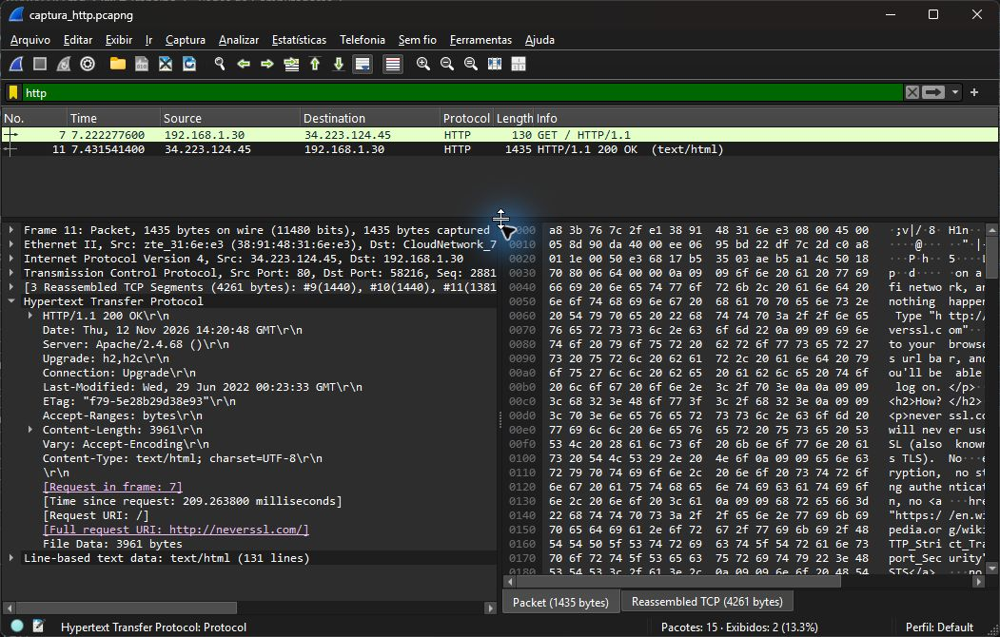

# Exercício 5 — Tráfego HTTP

Dependências: Wireshark com suporte a captura (Npcap no Windows) e curl. Não há dependências Python.
Captura realizada no Wi-Fi em 12/11/2026 com o `dumpcap`, componente do Wireshark.

Comandos executados a partir da raiz, em dois terminais; iniciar a captura antes da requisição:

```powershell
& 'C:/Program Files/Wireshark/dumpcap.exe' -i '\Device\NPF_{5486FE21-6D3C-47EB-905B-0650CC0EBAF4}' -f 'tcp port 80' -a duration:15 -w exercicio5/captura_http.pcapng
```

```powershell
curl.exe --noproxy '*' --http1.1 --max-time 10 -i http://neverssl.com/
```

O parâmetro `-i` identifica o Wi-Fi desta máquina; em outra máquina, consultar as interfaces com `dumpcap -D`. O destino é `neverssl.com`, porta TCP 80.
Para analisar, abrir `captura_http.pcapng` no Wireshark e aplicar o filtro de exibição `http`.

| Identificação | Valor observado |
| --- | --- |
| Requisição | Pacote 7: `GET / HTTP/1.1` |
| URL | `http://neverssl.com/` |
| Resposta | Pacote 11: `HTTP/1.1 200 OK` |
| Content-Type | `text/html; charset=UTF-8` |
| Server | `Apache/2.4.68 ()` |

Foi capturada uma requisição GET de `192.168.1.30` para `34.223.124.45:80`, acessando `http://neverssl.com/`.  
O pacote 7 contém a requisição e o pacote 11 apresenta a resposta `200 OK`.  
Na resposta, o cabeçalho `Content-Type` informa `text/html; charset=UTF-8`.  
O cabeçalho `Server` identifica `Apache/2.4.68 ()`; os campos HTTP estão legíveis na captura.


