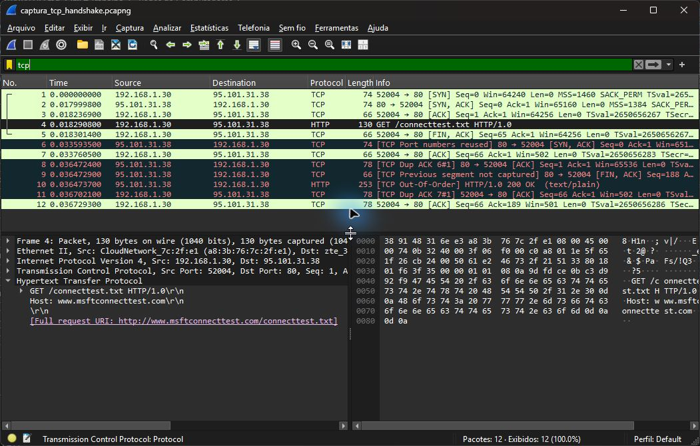

# Exercício 6 — Estabelecimento e encerramento TCP

Dependências: Wireshark com Npcap no Windows e `nc` (netcat-openbsd) no Ubuntu 24.04 via WSL. No Ubuntu, se necessário: `sudo apt install netcat-openbsd`. Não há dependências Python.
Captura realizada no Wi-Fi em 12/11/2026.

Comandos executados a partir da raiz, em dois terminais; iniciar a captura antes da conexão:

```powershell
& 'C:/Program Files/Wireshark/dumpcap.exe' -i '\Device\NPF_{5486FE21-6D3C-47EB-905B-0650CC0EBAF4}' -f 'host 95.101.31.38 and tcp port 80' -a duration:15 -w exercicio6/captura_tcp_handshake.pcapng
```

```powershell
wsl -d Ubuntu-24.04 -- bash -lc "printf 'GET /connecttest.txt HTTP/1.0\r\nHost: www.msftconnecttest.com\r\n\r\n' | nc -N -w 8 95.101.31.38 80"
```

O destino utilizado foi `95.101.31.38`, porta TCP 80. `-N` encerra o envio após o fim da entrada e `-w 8` limita a espera do nc.
O parâmetro `-i` identifica o Wi-Fi desta máquina; em outra máquina, consultar `dumpcap -D`.
Abrir `captura_tcp_handshake.pcapng` no Wireshark e aplicar `tcp`.
Para destacar apenas o handshake e o encerramento: `frame.number in {1, 2, 3, 5, 9, 12}`.

| Etapa | Pacote | Origem → destino | Flags |
| --- | --- | --- | --- |
| Abertura | 1 | `192.168.1.30:52004` → `95.101.31.38:80` | SYN |
| Abertura | 2 | `95.101.31.38:80` → `192.168.1.30:52004` | SYN, ACK |
| Abertura | 3 | Cliente → servidor | ACK |
| Encerramento | 5 | Cliente → servidor | FIN, ACK |
| Encerramento | 9 | Servidor → cliente | FIN, ACK |
| Confirmação final | 12 | Cliente → servidor | ACK |

A conexão com `nc` na porta 80 apresenta SYN, SYN-ACK e ACK nos pacotes 1, 2 e 3, formando o Three-Way Handshake.  
Após enviar a requisição, o cliente inicia o encerramento com FIN/ACK no pacote 5.  
O servidor envia FIN/ACK no pacote 9 e o cliente confirma todos os dados e o FIN com ACK no pacote 12.  
A captura também registra um SYN-ACK adicional no pacote 6 e a resposta HTTP fora de ordem no pacote 10, conforme sinalizado pelo Wireshark.


