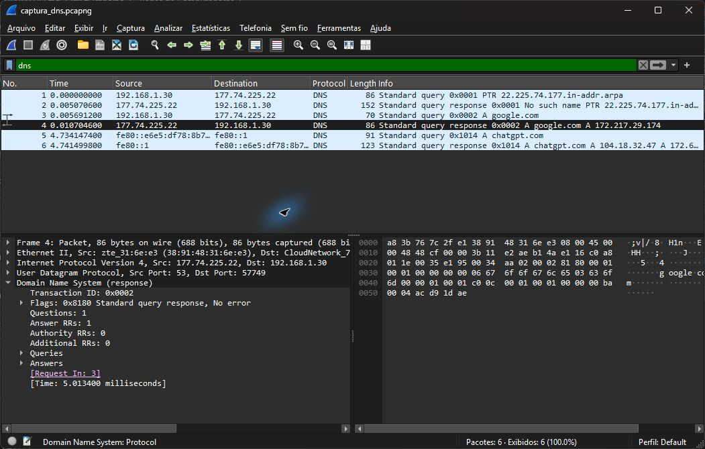

# Exercício 7 — Resolução de nomes via DNS


Dependências: Wireshark com Npcap e `nslookup` (disponível no Windows). Não há dependências Python.
Captura realizada no Wi-Fi em 12/11/2026.

Comandos executados a partir da raiz, em dois terminais; iniciar a captura antes da consulta:

```powershell
& 'C:/Program Files/Wireshark/dumpcap.exe' -i '\Device\NPF_{5486FE21-6D3C-47EB-905B-0650CC0EBAF4}' -f 'udp port 53' -a duration:10 -w exercicio7/captura_dns.pcapng
```

```powershell
nslookup -type=A google.com 177.74.225.22
```

Parâmetros: registro `A`, domínio `google.com`, servidor DNS `177.74.225.22`, porta UDP 53.
O parâmetro `-i` identifica o Wi-Fi desta máquina; em outra máquina, consultar `dumpcap -D`.
Abrir `captura_dns.pcapng` no Wireshark e aplicar `dns`. A consulta e a resposta do domínio estão nos pacotes 3 e 4; para isolá-las, usar `dns && dns.qry.name == "google.com"`.

| Identificação | Valor observado |
| --- | --- |
| Consulta | Pacote 3: `A google.com`, transação `0x0002` |
| Cliente | `192.168.1.30` |
| Servidor DNS de destino/origem | `177.74.225.22` |
| Resposta | Pacote 4: registro A `172.217.29.174` |

O pacote 3 registra uma consulta DNS do tipo A para `google.com`, enviada por `192.168.1.30` a `177.74.225.22`.  
O pacote 4 contém a resposta do mesmo servidor, com o identificador de transação `0x0002`.  
O registro retornado é A, com endereço IPv4 `172.217.29.174`.  
Os pacotes 1 e 2 correspondem à consulta PTR feita pelo nslookup para identificar o servidor; a consulta solicitada está nos pacotes 3 e 4.


