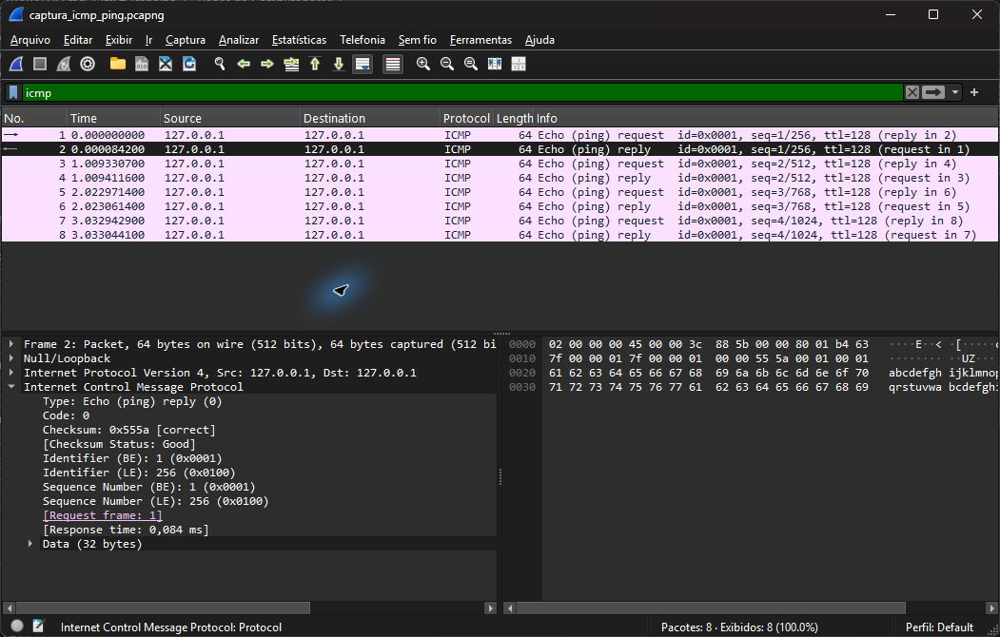

# Exercício 8 — Tráfego ICMP (ping)


Dependências: Wireshark com Npcap (captura de loopback) e `ping` do Windows. Não há dependências Python.
Captura realizada no adaptador de loopback em 12/11/2026.

Comandos executados a partir da raiz, em dois terminais; iniciar a captura antes do ping:

```powershell
& 'C:/Program Files/Wireshark/dumpcap.exe' -i '\Device\NPF_Loopback' -f icmp -a duration:8 -w exercicio8/captura_icmp_ping.pcapng
```

```powershell
ping -4 -n 4 127.0.0.1
```

Parâmetros: IPv4 (`-4`), quatro requisições (`-n 4`), destino local `127.0.0.1`. ICMP não utiliza portas TCP/UDP.
Abrir `captura_icmp_ping.pcapng` no Wireshark e aplicar o filtro `icmp`.
Nas respostas, expandir Internet Control Message Protocol para consultar `Response time`.

| Sequência | Echo Request (tipo 8) | Echo Reply (tipo 0) | RTT medido |
| --- | --- | --- | --- |
| 1 | Pacote 1 | Pacote 2 | 0,0842 ms |
| 2 | Pacote 3 | Pacote 4 | 0,0809 ms |
| 3 | Pacote 5 | Pacote 6 | 0,0900 ms |
| 4 | Pacote 7 | Pacote 8 | 0,1012 ms |

O ping para `127.0.0.1` produziu quatro Echo Request e quatro Echo Reply, sem perda na captura.  
Os pedidos estão nos pacotes 1, 3, 5 e 7, e as respectivas respostas nos pacotes 2, 4, 6 e 8.  
Os RTTs obtidos pelo Wireshark foram 0,0842 ms, 0,0809 ms, 0,0900 ms e 0,1012 ms, respectivamente.  
Como o destino é a própria máquina, todos os RTTs ficaram abaixo de 1 ms, valor apresentado como `tempo<1ms` pelo ping do Windows.


