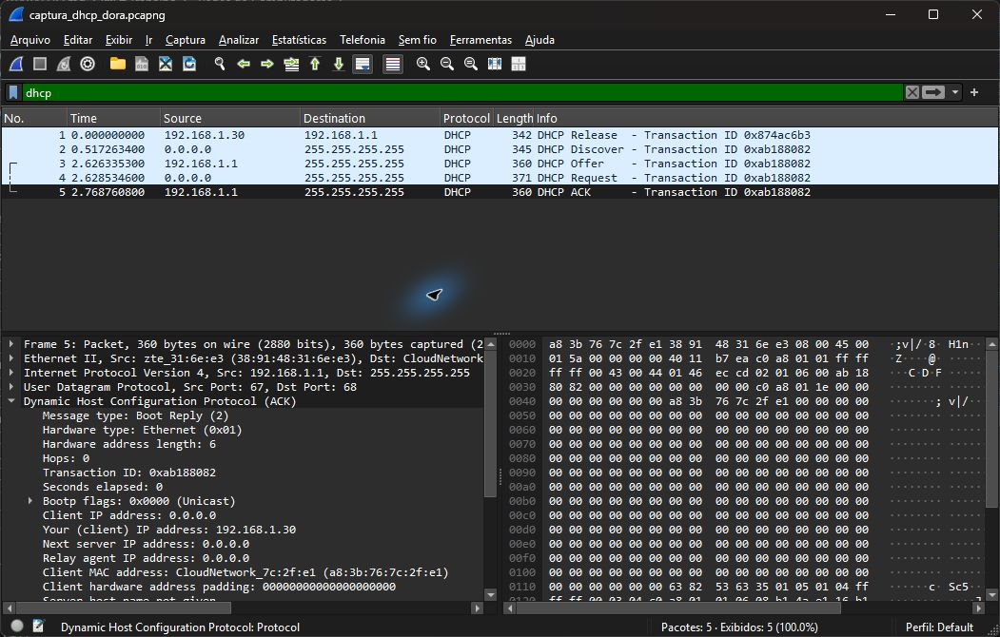

# Exercício 9 — Tráfego DHCP


Dependências: Wireshark com Npcap e `ipconfig` do Windows; rede Wi-Fi com DHCP habilitado. A liberação/renovação pode exigir terminal como administrador e interrompe a conexão temporariamente. Não há dependências Python.
Captura realizada no Wi-Fi em 12/11/2026.

Comandos executados a partir da raiz, em dois terminais; iniciar a captura antes de liberar o endereço:

```powershell
& 'C:/Program Files/Wireshark/dumpcap.exe' -i '\Device\NPF_{5486FE21-6D3C-47EB-905B-0650CC0EBAF4}' -f 'udp port 67 or udp port 68' -a duration:25 -w exercicio9/captura_dhcp_dora.pcapng
```

```powershell
try { ipconfig /release 'Wi-Fi' } finally { ipconfig /renew 'Wi-Fi' }
```

Parâmetros: adaptador `Wi-Fi`, portas UDP 67 (servidor) e 68 (cliente). O servidor observado é `192.168.1.1`.
O parâmetro `-i` identifica o Wi-Fi desta máquina; em outra máquina, consultar `dumpcap -D` e ajustar também o nome do adaptador no ipconfig.
Abrir `captura_dhcp_dora.pcapng` no Wireshark e aplicar `dhcp` (ou `bootp` em versões antigas). Para destacar somente DORA: `dhcp && frame.number >= 2`.

| Etapa | Pacote | Origem → destino | Identificação |
| --- | --- | --- | --- |
| Discover | 2 | `0.0.0.0` → `255.255.255.255` | Cliente procura servidor DHCP |
| Offer | 3 | `192.168.1.1` → `255.255.255.255` | Oferta do endereço `192.168.1.30` |
| Request | 4 | `0.0.0.0` → `255.255.255.255` | Solicita `192.168.1.30` ao servidor `192.168.1.1` |
| ACK | 5 | `192.168.1.1` → `255.255.255.255` | Confirma a concessão de `192.168.1.30` |

Após o DHCP Release do pacote 1, a renovação registrou as quatro etapas DORA nos pacotes 2 a 5.  
O cliente enviou Discover, e o servidor `192.168.1.1` respondeu com Offer para o endereço `192.168.1.30`.  
Em seguida, o cliente enviou Request solicitando esse endereço, e o servidor confirmou a concessão com ACK.  
As quatro mensagens compartilham o identificador de transação `0xab188082`, permitindo relacioná-las à mesma negociação.


